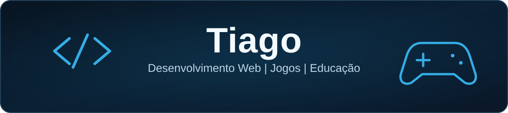

  

 

## 👋 Sobre mim

🎓 Estudante de **Desenvolvimento de Sistemas no COTIL-Unicamp**.

💻 Tenho interesse em desenvolvimento web, backend e criação de jogos. Gosto de transformar ideias em projetos e explorar diferentes tecnologias para aprimorar meus conhecimentos em programação.

### 🚀 Atualmente trabalhando em

**Bandeja | Projeto Integrador (PI)**

Atualmente, estou desenvolvendo em equipe o **Bandeja**, uma plataforma de compra e venda de alimentos entre estudantes.

O projeto envolve o desenvolvimento de um sistema com autenticação, gerenciamento de lojas, produtos e pedidos, utilizando **Node.js, Express e MySQL**.

## 🛠️ Tecnologias e ferramentas

**Linguagens**

  &nbsp;
  &nbsp;
  &nbsp;
  &nbsp;
  

**Backend e banco de dados**

  &nbsp;
  &nbsp;
  &nbsp;
  

**Ferramentas**

  &nbsp;
  &nbsp;
  &nbsp;
  

## 📂 Projetos em destaque

<table>
  <tr>
    <td>
      <h3>🎓 Cronos</h3>
      
Jogo educacional de História com atividades interativas, conteúdos históricos e desafios competitivos.

      
      
Código em repositório privado.

    </td>
  </tr>
  <tr>
    <td>
      <h3>🕵️ Infiltrado</h3>
      
Jogo social de dedução, com papéis secretos, diferentes categorias de palavras e sistema de votação.

      
      
    </td>
  </tr>
  <tr>
    <td>
      <h3>🧩 Conexão Nominal</h3>
      
Jogo de associação de palavras entre equipes, com pistas, estratégia e tabuleiros personalizáveis.

      
      
    </td>
  </tr>
</table>

## 🔗 Onde me encontrar

---

  <i>Sempre aprendendo, desenvolvendo e explorando novas ideias.</i>

